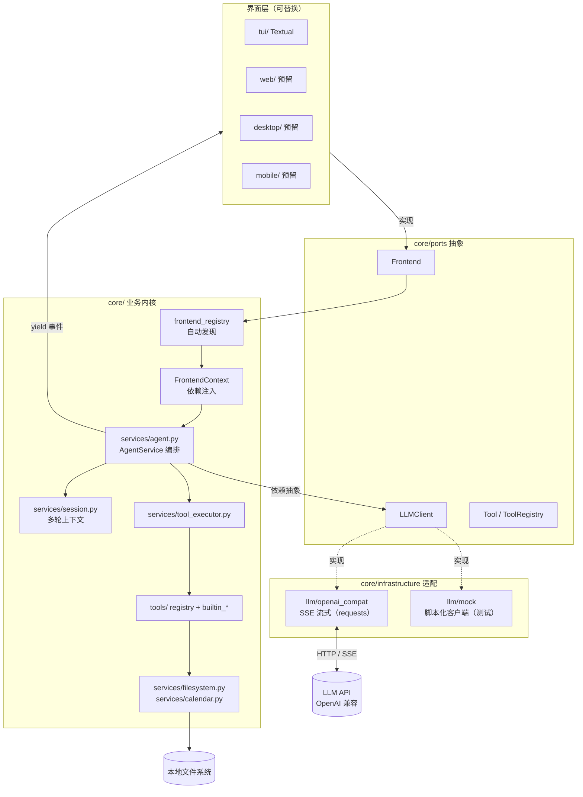
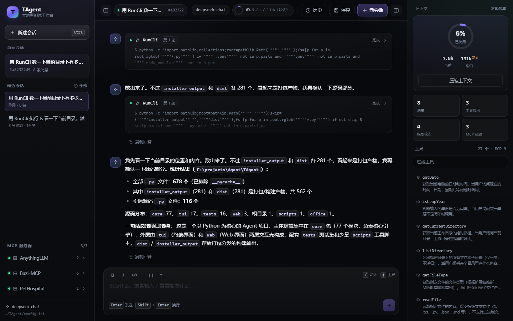
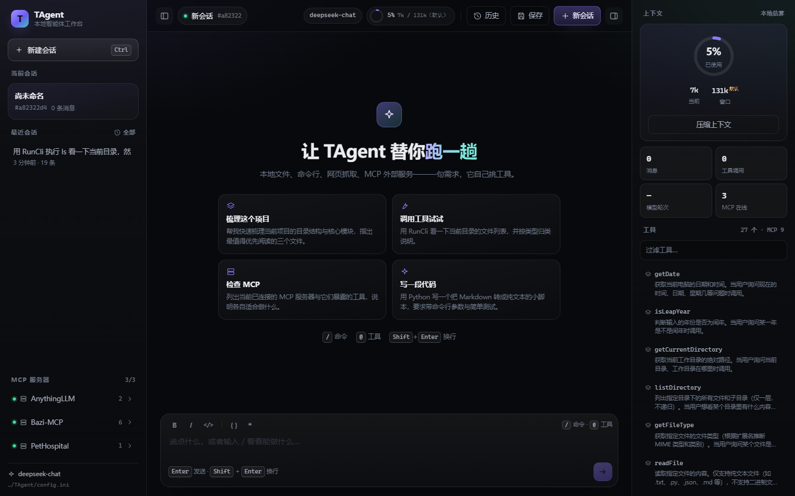
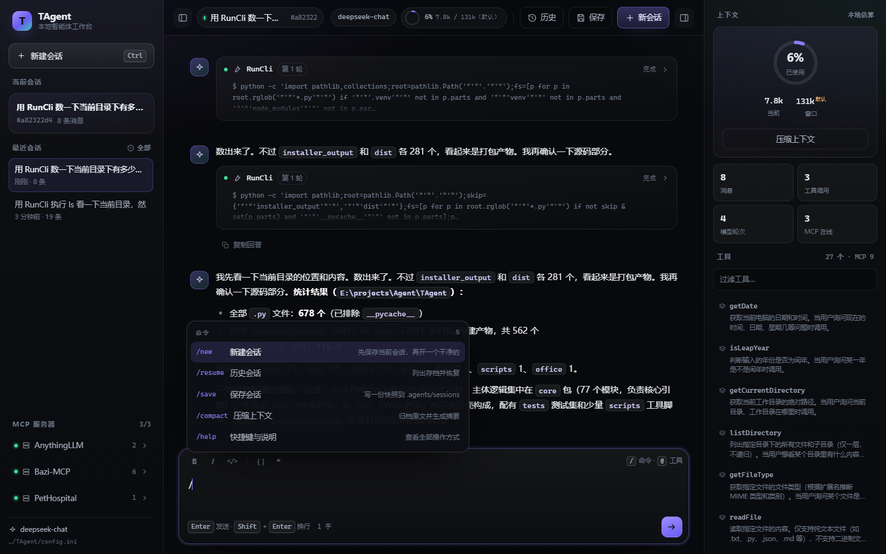

# TAgent —— 反诈助手（Anti-Fraud Agent）

面向公众与机构的反诈骗智能助手：识别诈骗话术、阻断正在进行的转账、指导止损报案、
支持家属劝阻与机构风控，并可作为反诈培训与演练的陪练。核心能力由内置技能包
`.agents/skills/anti-fraud/` 提供（36 类骗局图谱 + 18 条信号评分 + 定级输出规范），
人格与硬边界写在 `AGENTS.md`，回归用例在 `docs/anti-fraud/cases.json`。

底层仍是 core 与界面分离的 Agent 框架：**core 是零 UI 依赖的业务内核，tui / web 只是它的渲染器。**
新增界面只需在项目根目录新建一个与 `core/` 平级的目录。

---

## 快速开始

```bash
pip install -r requirements.txt

python run.py                       # 启动 TUI（默认）
python run.py --ui web              # 启动 Web 界面（浏览器里用）
python run.py --ui list             # 查看所有已注册界面
python run.py "当前工作目录是什么？"   # 带首问启动
python run.py --config ./my.ini     # 指定配置文件
```

Web 界面第一次用需要先构建一次前端（约 1 分钟，之后不用再装）：

```bash
cd frontend && npm install && npm run build && cd ..
python run.py --ui web              # 浏览器打开 http://127.0.0.1:8760
```

> **依赖必须装进"你实际运行 run.py 的那个解释器"。**
> 若 `python run.py` 报「无法加载界面 'tui'：缺少依赖 'textual'」，
> 按报错里给出的完整命令安装即可（它会带上当前解释器的绝对路径）：
>
> ```bash
> "C:\path\to\python.exe" -m pip install -r "E:\projects\Agent\TAgent\requirements.txt"
> ```
>
> 排查界面发现过程：`python run.py --ui list`（列出已注册 + 未能加载的界面及原因），
> 加 `--verbose` 可看到逐包诊断。

TUI 快捷键：

| 按键 | 作用 |
|---|---|
| `Enter` | 智能回车：**单行直接发送**；多行时换行，末行是空行再按 Enter 发送 |
| `Ctrl+J` | 强制换行（任何终端都可用） |
| `Shift+Enter` | 换行（终端能上报 Shift 时有效；见下方说明） |
| `Ctrl+S` | 强制发送（多行也不用等空行） |
| `Ctrl+X` | 中止本轮生成 |
| `Ctrl+N` | 开新会话（自动保存当前会话） |
| `Ctrl+R` | 打开历史会话列表（`/resume`） |
| `Ctrl+B` | 显示/隐藏左侧边栏（MCP 服务器与工具） |
| `Ctrl+T` | 显示/隐藏工具面板 |
| `Ctrl+K` | 清空工具面板 |
| `PageUp` / `PageDown` | 对话区上翻 / 下翻一页（输入框有焦点时也生效） |
| `Ctrl+End` | 跳回最新内容（恢复到自动跟随底部） |
| `Ctrl+Q` | 退出 |

> **关于 Shift+Enter**：Textual 在 Windows 上通过 `ReadConsoleInputW` 读键，
> 只读 `uChar.UnicodeChar`、**丢弃 `dwControlKeyState` 里的 Shift 状态**，
> 因此 Windows 终端里的 Shift+Enter 到达应用时就是一个普通 Enter。

> **关于滚动**：对话区可以用鼠标滚轮或 `PageUp` / `PageDown` 滚动。
> 生成过程中视图会自动跟随到底部；一旦你往上翻看历史，跟随会自动暂停，
> 不会被新内容拽回底部，按 `Ctrl+End` 或发送新消息即可恢复跟随。
> 这就是为什么换行不能只依赖 Shift+Enter：本实现额外提供了
> `Ctrl+J`（换行）与 `Ctrl+S`（发送），两者都只用控制字符，任何终端都能识别，
> 并且输入框上方会常驻一行按键提示，随时能看到当前是该用哪个键。

粘贴多行文本会原样进入输入框（`\r\n` 会自动归一化为 `\n`），不会误触发送。

等待模型回复时，输入框上方会显示**转圈动画**和当前状态（等待响应 / 生成中 / 调用工具 xxx）。

### 斜杠命令

输入 `/` 会自动弹出**补全面板**：`↑↓` 选择 · `Enter` 执行 · `Tab` 只补全命令名 · `Esc` 关闭。

| 命令 | 作用 |
|---|---|
| `/new` | 新建会话（自动保存当前会话） |
| `/resume` | 打开历史会话列表：`↑↓` 选择 · `Enter` 恢复 · `Esc` 取消 |
| `/save` | 保存当前会话（快照 + 事件日志） |
| `/sessions` | 列出历史会话（不切换） |
| `/compact` | 压缩上下文（先归档原始记录，再生成摘要） |
| `/clear` | 清空当前对话历史（保留会话与 AGENTS.md） |
| `/context` | 查看上下文用量、阈值与归档目录 |
| `/tools` | 列出当前可用工具 |
| `/mcp` | 查看 MCP 服务器与各自的工具 |
| `/skills` | 列出已发现的 Skill |
| `/model` | 查看模型、接口地址（密钥脱敏） |
| `/config` | 查看生效的配置文件与关键参数 |
| `/help` | 显示全部命令与快捷键 |
| `/quit` | 退出（退出前自动保存） |

### 首次启动：自动生成 config.ini

如果**当前工作目录**没有 `config.ini`，TAgent 会生成一份完整模板（`[llm]` 段是
`mock-api-key` / `mock-model` 之类的占位信息），并弹出对话框提示：
**请修改 `[llm]` 后重新启动**。这样新用户不会因为一个缺失的文件直接看到一段报错。

配置（`config.ini`，也支持 `TAGENT_BASE_URL` / `TAGENT_API_KEY` / `TAGENT_MODEL` 环境变量覆盖）：

```ini
[llm]
base_url = https://api.deepseek.com
api_key  = sk-xxx
model    = deepseek-chat
timeout  = 60

[agent]
max_tool_rounds = 10
max_read_bytes  = 1048576

; 界面、会话、AGENTS.md、MCP、上下文、命令执行、网页抓取各有专属段：
; [ui] [sessions] [agent_docs] [mcp] [context] [cli] [webfetch]
; 完整清单见 config.example.ini（每项都有注释与默认值）
```

---

## 反诈能力：怎么用、怎么验

启动后直接用自然语言描述处境即可，比如：

```
我接到一个电话，说是公安局的，说我账户涉嫌洗钱，让我把钱转到安全账户，还让我别告诉家人
```

助手会先中止操作、再给出命中信号与依据，最后才是共情与后续动作。三类输入的预期形态：

| 输入 | 期望输出 |
|---|---|
| 正在转账 / 已给验证码 / 正在共享屏幕 | 🔴 开头一句 ≤30 字中止指令 → 强提醒卡 → 止损与报案步骤 |
| 收到可疑短信、链接、兼职、投资邀请 | 🟡【提醒】+ 2~3 个核实动作 + 「未核实前不转账」 |
| 想了解骗局套路 / 做演练 / 写机构方案 | 🟢 正常讲解，按需读取技能包里的图谱与模板 |

技能包结构（`.agents/skills/anti-fraud/`，随仓库分发）：

| 文件 | 作用 |
|---|---|
| `SKILL.md` | 入口：四角色、四条铁律、六步工作流、红线 |
| `references/fraud-tactics.md` | 36 类骗局图谱与话术拆解 |
| `references/red-flags.md` | 18 条信号评分表、反向证伪、擦边球推路 |
| `references/verification-chain.md` | 真伪辨别链 L1–L6、证据标签、强提醒卡格式 |
| `references/personal-response.md` | 止损 → 固证 → 报案 → 追损 → 防二次 |
| `references/family-support.md` | 家属劝阻的三阶段话术与禁忌 |
| `references/enterprise-risk-control.md` | 涉诈账户特征、10 条监测规则、机构内控 |
| `references/legal-basis.md` | 反电诈法与帮信罪/掩隐罪对照 |
| `references/drill-workflow.md` | 四角色实战演练与六维评分 |
| `assets/*.md` | 书面《涉诈风险分析报告》《风控方案》模板 |
| `scripts/risk_score.py` | 可复现打分：`--signals S01,S03` / `--list` |

验证方式（用例集见 `docs/anti-fraud/cases.json`，10 个场景覆盖极高危/高危/中危/低危/无风险五档）：

```bash
python -m pytest tests/test_anti_fraud_skill.py -q   # 9 项：可发现性、文件完整性、打分一致性
python .agents/skills/anti-fraud/scripts/risk_score.py --signals S01,S03   # 手工试打分
```

`test_referenced_resources_all_exist` 会校验 SKILL.md 里引用的每个文件真实存在——
技能包最容易出的故障是「打包漏文件」，模型加载到一半 404 时极难排查，所以这条进了 CI。

---

## 目录结构

```
TAgent/
├── core/                      # ===== 核心层：不含任何 UI、不含 print/input =====
│   ├── errors.py              #   统一异常层级（UI 只需 except TAgentError）
│   ├── container.py           #   组合根：唯一负责把对象拼起来的地方
│   ├── frontend_registry.py   #   界面自动发现与注册
│   ├── config/                #   配置层：models（数据模型）+ loader（加载策略）+ template（首次生成）
│   ├── domain/                #   领域层：messages / events / filesystem / webpage / cli / skills / mcp / context 值对象
│   │                          #            frontmatter（SKILL.md 的解析与合成，纯文本逻辑）
│   │                          #            context（归档编号 / Token 估算 / 检索匹配，纯函数）
│   │                          #            sessions（会话摘要 / 存档记录 / 事件）
│   │                          #            agents（AGENTS.md 注入消息的渲染规则）
│   ├── ports/                 #   端口层：LLM、工具、前端、网页抓取、命令执行、Skill、MCP、
│   │                          #            上下文归档、会话存档的抽象契约
│   ├── services/              #   服务层：filesystem / calendar / webfetch / cli / skills / mcp / context /
│   │                          #            session / sessions（保存列表恢复）/ agents_docs / agent / tool_executor
│   ├── tools/                 #   工具层：把领域服务包装成 LLM 可调用的 function（mcp_tools 动态包装 MCP 工具）
│   └── infrastructure/        #   基础设施：llm/openai_compat（唯一 import requests 的地方）、
│                              #              webpage/curl_trafilatura（curl + trafilatura）、
│                              #              cli/local_subprocess（唯一 import subprocess 跑命令的地方）、
│                              #              skills/local_directory（唯一知道 Skill 磁盘布局的地方）、
│                              #              mcp/（唯一 import mcp SDK 的地方：json_config + sdk_client）、
│                              #              context/local_files（唯一知道归档 jsonl 布局的地方）、
│                              #              sessions/local_files（唯一知道会话 json + jsonl 布局的地方）
│
├── .agents/skills/            # ===== Agent Skills：每个子目录一个 Skill =====
│   └── demo-hello/SKILL.md    #   示例技能（可删）
│
├── .agents/context/           # ===== 压缩前的原始上下文归档（运行时生成，已 gitignore）=====
│   └── 20261022-153000.jsonl  #   编号 = 压缩时刻；recallContext 检索的就是这里
│
├── .agents/sessions/          # ===== 会话存档（运行时生成，已 gitignore）=====
│   ├── a1b2c3d4e5f6.json      #   快照：一次读取即可恢复整段对话
│   └── a1b2c3d4e5f6.jsonl     #   事件日志：创建 / 注入 AGENTS.md / 保存 / 恢复，只追加
│
├── AGENTS.md                  # ===== 项目约定（可选）：新会话首次加载时注入一次 =====
│
├── .mcp.json                  # ===== MCP Server 配置（启动目录下，缺省即不启用）=====
│
├── scripts/
│   └── mcp_stdio_bridge.py    #   把只写了 HTTP 启动方式的自建 MCP Server 以 stdio 拉起
│
├── tui/                       # ===== TUI 界面（Textual）=====
│   ├── frontend.py            #   Frontend 实现 —— core 认识它的唯一入口
│   ├── app.py                 #   App：布局 + 键盘 + 线程调度 + 斜杠命令分发
│   ├── commands.py            #   斜杠命令定义与解析（纯数据）
│   ├── bridge.py              #   防腐层：core 事件 → 界面动作
│   ├── styles.tcss            #   样式（换主题只改这个文件）
│   ├── text_utils.py          #   终端输入清洗（字面 \\uXXXX 转义还原、换行归一化）
│   ├── console_utf8.py        #   Windows 控制台 UTF-8 代码页切换与还原
│   └── widgets/               #   chat_view / message_card / tool_panel / status_bar /
│                              #   input_box / thinking_bar / sidebar（MCP）/ command_palette
│                              #   dialogs（历史会话列表、首次配置提示）
│
├── web/                       # ===== Web 界面（Python 侧网关）=====
│   ├── frontend.py            #   Frontend 实现：起 uvicorn、算静态目录、开浏览器
│   └── server.py              #   Starlette：API + SSE + 静态托管（唯一依赖 starlette 的地方）
│
├── frontend/                  # ===== 浏览器端工程（React + TS + Slate）=====
│   ├── src/
│   │   ├── App.tsx            #   三栏布局：侧边栏 / 对话 / 检查器
│   │   ├── useAgent.ts        #   状态机：把 SSE 事件增量合并成消息分块
│   │   ├── api.ts             #   与网关的唯一通信层（fetch + 手写 SSE 解析）
│   │   ├── editor/types.ts    #   Slate 节点类型与 → Markdown 序列化
│   │   ├── components/        #   Composer（Slate）/ ChatStream / ToolCard / Sidebar 等
│   │   └── theme.css          #   设计系统：颜色/圆角/节奏集中在这里
│   ├── dist/                  #   构建产物（已 gitignore，后端自动托管）
│   └── vite.config.ts         #   开发服务器：/api 代理到 127.0.0.1:8760
│
├── desktop/  mobile/          # 预留：其它界面形态（见各自 README）
├── tests/                     # core / tui / web 的测试
├── run.py                     # 统一启动入口
└── config.ini
```

---

## 分层架构

依赖方向**只能由外向内**，内层永远不知道外层的存在：

```
   界面层   tui/    web/    desktop/    mobile/     （可替换、可并存）
      │        └──── 都实现 core.ports.frontend.Frontend ────┘
      ▼
   应用层   core/services/agent.py        AgentService：对话编排 + 事件流
      ▼
   领域层   core/domain/  core/services/  filesystem / calendar / session
      ▼
   端口层   core/ports/                   LLM、Tool、Frontend 的抽象接口
      ▲
   适配层   core/infrastructure/llm/      OpenAI 兼容 SSE 客户端 / Mock 客户端
```

### 三条硬约束（新增代码必须遵守）

| # | 约束 | 目的 |
|---|---|---|
| 1 | `core/` 内不得 import 任何 UI 框架（textual / fastapi / PySide …） | 换界面不改业务 |
| 2 | `core/` 内不得出现 `print` / `input`；对外只 `yield` 事件 | 核心可脱离终端测试 |
| 3 | 第三方 SDK（requests 等）只允许出现在 `core/infrastructure/` | 换后端不改业务 |

> 约束 2 有回归测试：`tests/test_agent.py::test_core_never_prints`。

### 关键设计

- **事件驱动**：`AgentService.stream_turn()` 是生成器，逐条 `yield` 领域事件
  （`TurnStarted` → `AssistantTextDelta*` → `ToolCallStarted/Completed` → `TurnCompleted`）。
  界面只是这些事件的不同渲染器。
- **依赖倒置**：`AgentService` 依赖 `LLMClient` 抽象而非 `requests`，
  因此测试里换成 `ScriptedLLMClient` 就能跑通全链路（含工具调用）。
- **结构化工具结果**：文件操作返回 `DirectoryListing` / `FileTypeInfo` / `EditSummary` 等
  值对象，再 `render()` 成给模型看的文本——Web 端可直接渲染结构化数据，无需反解析。
- **组合根**：`AppContainer` 是唯一 `new` 的地方，业务模块之间只依赖抽象。
- **前端零配置发现**：`Frontend.__init_subclass__` 自动登记，`core.frontend_registry`
  扫描与 `core/` 平级的目录完成发现。

### 架构图



---

## 内置工具（18 个）

| 工具 | 说明 | 实现位置 |
|---|---|---|
| `getDate` | 当前日期时间（调系统 `date`，失败回退 Python） | `services/calendar.py` |
| `isLeapYear` | 闰年判断 | `services/calendar.py` |
| `searchwdb` | 联网搜索（百度千帆智能搜索生成 API，返回摘要 + 参考来源） | `services/websearch.py` |
| `fetchWeb` | 抓取网页正文转 Markdown（curl + trafilatura，去导航/广告/页脚） | `services/webfetch.py` |
| `RunCli` | 执行本机已安装的命令行程序，返回 stdout / stderr / 退出码 | `services/cli.py` |
| `LoadSkill` | 按需加载 Skill 的完整说明或附加文件（动态加载） | `services/skills.py` |
| `createSkill` | 按用户要求创建新 Skill（生成规范的 `SKILL.md`，绝不覆盖） | `services/skills.py` |
| `recallContext` | 在已压缩的历史归档中做关键词全文检索（`text` 必填、`id` 可选） | `services/context.py` |
| `getCurrentDirectory` | 当前工作目录 | `services/filesystem.py` |
| `listDirectory` | 列举目录一层条目 | 同上 |
| `getFileType` | 按扩展名推断 MIME / 类别 / 大小 | 同上 |
| `readFile` | 读纯文本（拒绝二进制，UTF-8/GBK 探测） | 同上 |
| `createFile` | 建文件（自动建目录，不覆盖） | 同上 |
| `editFile` | 替换或整体覆盖，保持原编码 | 同上 |
| `createDirectory` / `deleteDirectory` / `deleteFile` / `renameItem` | 目录与文件变更 | 同上 |

> 上表是**本地**工具（18 个）。MCP 工具是**运行时动态注册**的，数量取决于
> `.mcp.json` 里配置了哪些服务器、每个服务器提供多少工具，因此不计入上表。
> 它们和本地工具完全平级地参与 Function Calling，见下一节。

### fetchWeb 抓取工具

调用本地 `curl`（参数列表方式，**不用 `shell=True`**）拉取 HTML，
再用 `trafilatura` 提取正文并转 Markdown，保留标题 / 段落 / 列表 / 表格 / 链接，
去掉导航、广告、页脚。结果带 `【来源】` 脚注与「HTML→正文」压缩比，
正文默认截断到 20000 字符以控制 Token 消耗。

**多策略级联提取**：trafilatura 默认参数偏「精度优先」，在国内高校 / 政企 CMS
的 table 布局 + 图片正文页面上会把整篇正文判空（实测某高校新闻页 0 字符）。
因此按「默认 → `favor_recall` → `favor_recall`+评论」逐级放宽，
取最长结果，拿到足够长的正文即提前停止；全部失败才算解析失败。

失败时给出语义明确的错误（`core/errors.py` 的 `WebFetchError` 子类）：
非法 URL / curl 不存在 / 超时 / 主机不可达 / HTTP 4xx 5xx / HTML 解析失败 / 正文过短。

> `trafilatura` 需要额外安装：`pip install trafilatura`（已加入 `requirements.txt`）。

### RunCli 命令行工具

让 Agent 调用本机**任意已安装**的命令行程序，并把「标准输出 / 标准错误 / 退出码 /
耗时」原样交回模型，由模型判断结果并决定下一步（改参数重试 / 换命令 / 向用户说明）。

```jsonc
// 模型实际发出的调用
{ "command": "git", "args": ["status", "--short"] }
```

```text
// 回传给模型的文本
$ git status --short

退出码：0（耗时 47 ms）

【stdout】
 M README.md
?? core/domain/cli.py

【stderr】
（无）
```

设计要点：

| 关注点 | 做法 |
|---|---|
| 执行方式 | 程序名与参数拼成**列表**，`subprocess.run(argv, shell=False)`，绝不拼接 shell 字符串 |
| 注入安全 | 不经 shell 解释，`&` `\|` `>` 空格等都被当作普通字符（有回归测试覆盖） |
| 卡死防护 | `stdin` 接 `DEVNULL`，避免程序等交互输入把 Agent 挂起 |
| 超时 | 默认 30 秒（`LocalSubprocessRunner(timeout=...)`），超时即终止 |
| 超时后仍可用 | 保留终止前已产生的**部分输出**，并标注「执行超时已被终止」，便于模型排查 |
| 输出截断 | stdout ≤ 8000 字符、stderr ≤ 4000 字符；截断时**保留开头与结尾**（关键信息常在末尾），中间用 `…（已省略 N 字符）…` 标注 |
| 编码 | 解码顺序 utf-8 → gb18030（Windows 中文终端）→ latin-1 |
| 退出码语义 | 非 0 **不是**工具故障，原样呈现让模型结合 stderr 判断；只有「程序不存在 / 无法启动」才算工具失败 |
| 参数校验 | `args` 必须是字符串数组；收到字符串直接报错（若偷偷 `shlex.split` 就退化成 shell 语义） |

> **安全边界（重要）**：本阶段教学目标是让学生看清「Agent 调用本地工具」的完整链路，
> 因此**暂未实现**命令白名单 / 黑名单 / 人工审批——命令以**运行 TAgent 的当前用户权限**
> 直接执行。请仅在受控的教学实验环境中使用；护栏（白名单 + 危险命令拦截 + 审批）
> 属于下一阶段的扩展点，加在 `CommandService.validate()` 一处即可对全系统生效。

### Agent Skills：LoadSkill 动态加载 与 createSkill 创建

遵循 Agent Skills 规范：**Skill 的正文只有在模型决定要用时才进入上下文**。

```
<项目根>/.agents/skills/          ← 项目根 = 程序启动时的工作目录
    demo-hello/
        SKILL.md                  ← 入口，开头是 YAML Frontmatter
    code-review/
        SKILL.md
        scripts/lint.py           ← 附加文件（按需加载）
```

`SKILL.md` 的开头必须声明 `name` 与 `description` 两个字段：

```markdown
---
name: code-review
description: 审查 Python 代码风格与常见缺陷，并给出逐条修改建议。
---

# code-review
…完整指令…
```

**初始化阶段**只扫描出 `name` + `description`（正文一个字节都不读），
整理成清单追加到 System Prompt 末尾：

```
You have access to the following skills:
- 'code-review': 审查 Python 代码风格与常见缺陷，并给出逐条修改建议。
- 'demo-hello': 演示 Skill 的写法与按需加载用法。
Use the 'LoadSkill' tool to load the full instructions of a skill when needed.
You can also load additional files referenced by a skill.
```

**运行时**由模型自己决定要不要深挖，调用 `LoadSkill`：

```jsonc
{ "name": "code-review" }                          // 加载 SKILL.md 全文
{ "name": "code-review", "filename": "scripts/lint.py" }   // 只加载附加文件
```

| 关注点 | 做法 |
|---|---|
| 目录基准 | 项目根 = **程序启动时的工作目录**；可用 `config.ini` 的 `skills_dir` 覆盖 |
| 懒加载 | 发现阶段只读 Frontmatter（先扫 8KB，命中即止），正文永不进上下文 |
| 路径兼容 | `filename` 支持相对 Skill 目录、项目相对、绝对路径；只给文件名时**在该 Skill 目录内递归查找** |
| 歧义处理 | 同名文件有多个时返回候选路径列表，由模型指定更精确的路径重试 |
| 越界防护 | 读取范围**锁定在 Skill 目录内部**；`..` 穿越与目录外绝对路径一律拒绝 |
| 坏 Skill 不炸 | 缺 `SKILL.md`、Frontmatter 少字段、重名 → 记进 `SkillCatalog.issues` 后跳过，不影响其它技能 |
| YAML 依赖 | 装了 PyYAML 就用它；没装则用内置最小解析器（`key: value` + `|`/`>` 块标量），零依赖可跑 |

#### 让模型自己创建 Skill：`createSkill`

用户说「帮我把这个流程固化成技能」时，模型调用：

```jsonc
{
  "name": "code-review",
  "skillContext": "---\nname: code-review\ndescription: 审查代码改动并给出改进建议\n---\n\n# 步骤\n1. 先看 git diff\n2. 检查空指针与异常分支"
}
```

| 关注点 | 做法 |
|---|---|
| 目录位置 | `<项目根>/.agents/skills/<name>/SKILL.md`（项目根 = 启动时的工作目录） |
| 名称规范 | 归一化为小写字母 / 数字 / 连字符（`Code Review` → `code-review`）；纯中文名**直接报错**并提示改用英文名 |
| Frontmatter | 无论模型写没写、写对没写对，最终都由服务层重写成规范格式，`name` 强制与目录名一致 |
| description | 缺省时从正文首行自动提炼——否则发现阶段会把它判为无效技能 |
| 绝不覆盖 | 目标 `SKILL.md` 已存在 → 明确报错、一个字节都不写；写入用 `x` 模式，并发调用也只有一方成功 |
| 目录复用 | 目录已存在但没有入口文件（例如模型先建好了 `references/`）→ 复用该目录 |
| 后续文件 | `references/`、`scripts/` 等由模型继续调用 `createFile` / `createDirectory` 完成 |

创建成功后清单立即刷新，**同一轮对话里**就能用 `LoadSkill` 加载它；
System Prompt 中的技能列表要等下次启动 / 新会话才会出现。

> Skill 与其它工具是**平级协作**关系：`LoadSkill` 只是注册在同一个
> `ToolRegistry` 里的一个普通工具，读到的指令里可以直接让模型去调 `RunCli`、
> `createFile`、`fetchWeb` 等任何已有工具，既有工作流程一行都没改。

仓库里附带了一个示例技能 `.agents/skills/demo-hello/`，确认机制可用后可整个删除。

---

## MCP Client：连接外部 MCP Server

TAgent 既是「工具提供方」，也是「工具使用方」：启动时按 `.mcp.json`
连接外部 [MCP](https://modelcontextprotocol.io) 服务器，把对方提供的工具
**动态注册**进本地工具集合，模型调用时跟调 `RunCli`、`fetchWeb` 没有任何区别。

支持三种传输：`stdio`（拉起子进程）、`streamable_http`、`sse`。

### 配置文件

放在**当前项目目录**（= 程序启动时的工作目录，与 `.agents/skills/` 同一基准）：

```json
{
  "mcpServers": {
    "Bazi-MCP": {
      "type": "streamable_http",
      "url": "https://mcp.api-inference.modelscope.net/<your-uuid>/mcp"
    },
    "local-fs": {
      "command": "npx",
      "args": ["-y", "@modelcontextprotocol/server-filesystem", "."],
      "env": {"DEBUG": "0"},
      "cwd": ".",
      "timeout": 60
    }
  }
}
```

| 字段 | 适用 | 说明 |
|---|---|---|
| `type` | 全部 | `stdio` / `streamable_http`（别名 `http`、`streamable-http`）/ `sse`；省略时按 `command` / `url` 自动推断 |
| `command` `args` `env` `cwd` | stdio | 启动命令；`env` 为追加变量，未列出的继承父进程；相对 `cwd` 按配置文件所在目录解析 |
| `url` `headers` | http / sse | 服务地址（必须 http(s)://）与附加请求头，可用于携带 Token |
| `timeout` | 全部 | 单次工具调用超时（秒），缺省取 `[agent] mcp_timeout` |
| `disabled` | 全部 | `true` 时跳过该服务器（保留配置但暂不连接） |

> ModelScope 托管的地址形如 `https://mcp.api-inference.modelscope.net/<uuid>/mcp`：
> 既要带上自己的 `<uuid>`，也要带末尾的 `/mcp`。只写前缀时服务器会返回 404。
>
> **托管链接是有有效期的**（默认 24 小时，控制台里可以改长）。过期后服务器回
> `410 Gone` + `{"error":{"message":"Url is expired"}}`，看起来像「连不上」，
> 其实只是地址作废了——回控制台点一下「重新生成」即可；想彻底免维护，
> 就用下面的 stdio 方式在本地跑（例如把八字服务换成 `npx -y @openfate/bazi-mcp`）。
>
> 到 [modelscope.cn/mcp](https://modelscope.cn/mcp) 复制完整地址最稳；即使漏了后缀，
> TAgent 也会**自动补一次 `/mcp`（SSE 补 `/sse`）再连**，接通后在对话区提示你改成正确地址。

### 地址自动补全

托管服务的控制台经常只给「前缀」地址，例如：

```
https://mcp.api-inference.modelscope.net/4a3222faa31a4e       ← 404 Invalid session id.
https://mcp.api-inference.modelscope.net/4a3222faa31a4e/mcp   ← 200 OK
```

为减少这类「地址少一段」的坑，TAgent 连接失败且判定为「地址不对」时会自动再试一次补全后的地址：

| 配置里的 `url` | 是否补全 | 实际尝试 |
|---|---|---|
| `https://host/4a3222faa31a4e`（单段路径） | 补 `/mcp` | 原地址 → `/4a3222faa31a4e/mcp` |
| `https://host`（无路径） | 补 `/mcp` | 原地址 → `/mcp` |
| `https://host//mcp`（重复斜杠） | 归一化 | `https://host/mcp` |
| `https://host/mcp`（已带后缀） | 不补 | 只试原地址 |
| `https://host/api/v1`（多级路径） | 不补 | 只试原地址 |

只在错误看起来是「404 / Not Found / Invalid session id」时才换候选，所以正常配置不会产生多余请求、
真正的故障（401、连接被拒）也不会被掩盖。补全成功后会在启动提示里给出实际使用的完整地址。

### 接入本地自建的 MCP Server

自己写的 MCP Server 常常只在 `__main__` 里写了 `mcp.run(transport="streamable-http")`，
于是「每次用之前得先手动开一个服务」。这种项目可以直接交给 TAgent 用 **stdio** 拉起：
`scripts/mcp_stdio_bridge.py` 会在子进程里把项目目录加进 `sys.path`，取到 `MCPServer`
对象后以 stdio 运行——**不改对方一行源码**，且 TAgent 退出时子进程自动回收。

```json
{
  "mcpServers": {
    "AnythingLLM": {
      "type": "stdio",
      "command": "C:/Users/you/.workbuddy/binaries/python/versions/3.13.12/python.exe",
      "args": [
        "E:/projects/Agent/TAgent/scripts/mcp_stdio_bridge.py",
        "E:/projects/AnythingLLM_MCP",
        "server"
      ],
      "timeout": 120
    },
    "PetHospital": {
      "type": "stdio",
      "command": "E:/projects/pet_hospital_mcp/.venv/Scripts/python.exe",
      "args": [
        "E:/projects/Agent/TAgent/scripts/mcp_stdio_bridge.py",
        "E:/projects/pet_hospital_mcp",
        "pet_hospital_mcp.server"
      ],
      "env": { "PET_HOSPITAL_BASE_URL": "http://127.0.0.1:8080" },
      "timeout": 60
    }
  }
}
```

桥接器参数：`mcp_stdio_bridge.py <项目目录> <模块名> [变量名] [--env K=V ...]`

- `<模块名>` 是 `server`（单文件）或 `pet_hospital_mcp.server`（src 布局的包）；
- `[变量名]` 省略时取约定俗成的 `mcp`；找不到时会在 stderr 里列出模块里可用的 `MCPServer`；
- `--env K=V` 可重复，用来传上游地址一类的环境变量（也可以在配置里用 `env` 字段）；
- **诊断信息只写 stderr**，绝不污染 stdout 上的 JSON-RPC 流。默认被丢弃，
  排查时设 `TAGENT_MCP_STDERR=1` 就能看到。

> 用 HTTP 传输也完全支持（两个服务都能连），只是要先自己把服务跑起来。
> 若两个服务默认都占 8000 端口，用 `MCP_PORT` 之类的环境变量错开即可。

### 名称映射与冲突

不同服务器常有同名工具（如都叫 `search`）。暴露给模型的名称统一加前缀：

```
mcp__<服务器键>__<原始工具名>        例如 mcp__bazi-mcp__paipan
```

- 服务器键由服务器名归一化而来（小写、非字母数字转 `-`，纯中文名退化为 `server-<hash>`）；
- 工具名中的非法字符转 `_`，总长严格 ≤ 64（OpenAI function name 上限），超长截断并加短哈希；
- 仍然撞名时追加 `_2`、`_3`；与本地工具重名时**本地优先**，MCP 那个换名。

内部维护 `暴露名 → (服务器, 原始工具名)` 的映射表，调用时先查表再用**原始工具名**转发，
所以服务器永远看到自己认识的名字。模型想调本地工具也完全不受影响。

### 失败处理

| 场景 | 行为 |
|---|---|
| 某个服务器连不上 / 握手失败 / 超时 | **只跳过这一台**，它提供的工具不注册，其余服务器与全部本地工具照常工作 |
| 启动时 | 状态栏显示 `MCP 1/2 · 3 个工具（Bazi-MCP 未连接）`，对话区给出失败原因 |
| 地址疑似不全（404 / Invalid session id） | 自动补 `/mcp`（SSE 补 `/sse`）重试一次；仍失败则提示「核对路径后缀或鉴权 headers」 |
| HTTP 连接失败（410 / 401 / 404 / 5xx） | 失败后**额外裸 POST 一次 `initialize` 探明真实状态码**（SDK 会把状态码和响应体吞掉），按状态码给出可操作结论：`410` 地址过期、`401/403` 缺鉴权 headers、`404` 路径不对、`5xx` 对方故障 |
| 单条服务器配置写错 | 跳过该条并在启动提示里说明，不阻断启动 |
| `.mcp.json` 整体非法 | 记录错误并继续启动（本地工具可用） |
| 调用时超时 / 服务器报错 | 转成 `ToolOutcome.failure`，模型看到明确原因后自行决定换工具或向用户解释 |

### 返回结果的处理

MCP 的 `CallToolResult` 会被还原成三部分再交给模型：

- **文本块**：按顺序拼接；图片 / 音频 / 二进制资源只给占位说明（不塞 base64 进上下文）；
- **结构化数据**：`structuredContent` 以 JSON 追加；若它只是把同样的文本包了一层（很常见），自动去重；
- **`isError`**：标记为工具失败，并附上服务器给的错误文本。

单条结果超过 20000 字符时保留头 70% + 尾 30%，中间标注省略量。

### 架构：异步 SDK 如何接入同步 Agent

MCP 官方 SDK 全程 async，而 TAgent 的 Agent 循环是同步生成器。
若把 `async` 暴露到端口层，asyncio 会传染到 services / tools / tui 每一处。

因此 `core/ports/mcp.py` 定义的是**同步**契约，异步细节全部收在
`core/infrastructure/mcp/sdk_client.py` 里：

- **每台服务器一个守护线程 + 一个事件循环**，故障天然隔离；
- 线程里跑一个长期存活的 task：连接 → `initialize` → `list_tools` → 循环消费请求队列，
  **所有协议交互都在同一个 task 内串行执行**。这不是随意选择：anyio 的 cancel scope
  要求「进入与退出在同一个 task」，跨 task 复用 session 会直接抛错；
- 工具调用通过 `asyncio.Queue` 投递需求、`concurrent.futures.Future` 回传结果，
  对上层表现为普通的阻塞函数；
- 启动时用线程池**并行**连接各服务器，总耗时 ≈ 最慢的那一台，而不是累加；
- 子进程 stderr 默认丢弃（否则会冲花 TUI 画面），排查时设 `TAGENT_MCP_STDERR=1` 即可看到。

### 相关配置

```ini
[agent]
mcp_enabled = true            ; 关掉后完全不读 .mcp.json、不连任何服务器
; mcp_config = D:\shared\.mcp.json   ; 留空 = 启动目录\.mcp.json
mcp_timeout = 60              ; 单次工具调用超时（秒）
mcp_connect_timeout = 15      ; 连接与握手超时（秒）
```

> 依赖：`pip install "mcp>=2.0.0"`（已写入 `requirements.txt`）。
> 没装也不会崩溃：MCP 功能不可用，本地工具与 Skills 照常运行，启动时会给出明确提示。

---

## 上下文压缩：在有限窗口里做长任务

长任务迟早会撞上模型的上下文窗口。TAgent 的做法刻意保持简单——
**不用向量库、不用 Embedding**，只做三件事：把原始记录存成本地 jsonl、
让模型写一份约 5,000 Tokens 的摘要替换历史、需要细节时用 `recallContext` 全文检索捞回来。

### 用法：`/compact`

在输入框里输入 `/compact` 回车即可（`/help` 可查看所有命令）。压缩期间：

- **禁止任何 Function Calling**：压缩请求的 `tool_specs` 传空列表，模型根本拿不到工具声明；
- **禁止普通输入**：输入框锁定，此时发消息只会收到提示；
- 状态栏显示「正在压缩上下文…」，完成后自动解锁。

一次压缩的固定顺序（**顺序不可颠倒**）：

```
① 计算当前用量
② 序列化全部非 system 消息
③ 写入 .agents/context/<编号>.jsonl      ← 必须先成功，否则中止
④ 调 LLM 生成摘要（不带工具定义）
⑤ 校验摘要非空、超长则截断
⑥ 用「摘要 + 归档说明」替换会话历史（System Prompt 原样保留）
```

任何一步失败都**不会破坏上下文**：

| 失败点 | 结果 |
|---|---|
| ③ 归档写入失败 | 抛 `ContextArchiveError`，会话一行未改 |
| ④⑤ 摘要生成失败 / 为空 | 抛 `ContextCompactError`，归档已留存（无害），会话未改 |
| 失败之后 | 直接再输入 `/compact` 重试即可 |

### 归档文件

```
<启动目录>/.agents/context/20261022-153000.jsonl
```

每行一个 JSON，人能直接 `grep`：

```jsonl
{"type":"meta","archive_id":"20261022-153000","archived_at":"2026-10-22 15:30:00","message_count":42,"tokens_before":91234}
{"seq":1,"role":"user","content":"把这个项目改成分层架构"}
{"seq":2,"role":"assistant","content":null,"tool_calls":[{"id":"c1","name":"readFile","arguments":"{\"path\":\"core/app.py\"}"}]}
{"seq":3,"role":"tool","tool_call_id":"c1","content":"# 文件内容…"}
```

- 角色、正文、工具调用参数、工具返回结果、消息顺序全部保留；
- 编号是 `YYYYMMDD-HHMMSS`；同一秒重复压缩自动加 `-1`、`-2`，**绝不覆盖旧归档**；
- 写入用「临时文件 + 原子 rename」，中途崩溃不会留下半份文件；
- system 提示词不进归档（它属于能力定义，压缩后仍保留）。

### 摘要替换后的会话

压缩后历史只剩两条：

```
system：<原 System Prompt，原样保留>
user  ：<约 5,000 Tokens 的 Markdown 摘要> + <归档说明>
```

归档说明长这样（模型据此知道可以回查）：

> 此前上下文已于 2026-10-22 15:30:00 完成压缩，原始上下文保存在编号为 20261022-153000 的归档文件中。如需查找历史信息，请使用 recallContext 工具。

### `recallContext` 工具

| 参数 | 必填 | 说明 |
|---|---|---|
| `text` | 是 | 关键词或短语；多个词用空格分隔，**全部命中**才算匹配 |
| `id` | 否 | 归档编号；省略时检索全部归档（最新优先） |

返回命中的原始片段 + 归档编号 + 在归档中的序号与角色。匹配是按行
（= 按消息）做的全文检索，大小写不敏感；单条片段截到 600 字符，
结果总量上限 8,000 字符，避免「检索结果又把上下文塞满」。

```
【归档 20261022-153000 · 第 12 条 · tool】
…命中位置前后的原文…
```

### 用量监控与 80% 阈值

每次模型响应结束都会刷新用量（状态栏右侧）：

```
上下文 12k / 128k（默认） · 9%
```

- **优先用模型 API 返回的 usage**（请求里带了 `stream_options.include_usage`）；
  拿不到时按「1 个中文字符≈1 token、4 个英文字符≈1 token」估算，
  估算范围包括 System Prompt、全部消息与工具声明；
- 状态栏带「（默认）」表示没配置窗口大小，按 128k 假设计算；
- 达到阈值（默认 **80%**）时：对话区给出一次警告，并**暂停接受普通输入**，
  直到 `/compact` 成功（或按 `Ctrl+N` 开新会话）才恢复；
- 若厂商不支持 `stream_options`（返回 400），客户端会自动去掉该字段重试一次，
  宁可退化成估算也不让对话失败。

### 配置

上下文相关参数集中在 `[context]` 段（旧的 `[agent] context_window / compact_threshold / context_dir` 仍然兼容，专属段优先）：

```ini
[context]
; 模型上下文窗口（token）。0 或省略 = 未知，按 128k 处理并在状态栏标「默认」
window = 128000

; 达到窗口的该比例时提示 /compact 并暂停普通输入
threshold = 0.8

; 归档目录（可选）。留空 = 启动目录\.agents\context
; dir = D:\shared\tagent-context

; 摘要目标 token 数；recallContext 单次返回上限
summary_tokens = 5000
recall_max_chars = 8000
```

### 为什么这么设计

- **不引入向量库**：归档按消息逐行存，检索就是关键词匹配——学生能读懂、
  能自己改，且不需要额外依赖或索引构建；
- **压缩期间禁工具**：不是靠提示词「请勿调用工具」，而是让模型在协议层面
  没有可调用的工具，从根上杜绝；
- **先归档再压缩**：摘要一定会丢细节，只有原始记录先落盘，`recallContext`
  才有东西可查；这也让「压缩失败」成为安全操作；
- **摘要放在 user 消息里**：多数厂商对 `system` 位置较敏感，放 user 更通用，
  且 System Prompt 仍然完整保留在第一条。

---

## 会话存档：`/save` · `/new` · `/resume`

会话在三个时机自动保存：**每轮对话结束**、**`/new` 之前**、**退出程序时**
（`[sessions] autosave = false` 可关掉，只保留手动 `/save`）。

```
.agents/sessions/
    a1b2c3d4e5f6.json      ← 快照：标题、时间、System Prompt、全部消息（原子覆盖写）
    a1b2c3d4e5f6.jsonl     ← 事件日志：snapshot / agents_doc_injected / resumed …（只追加）
```

- **为什么两份文件**：快照负责「一次读取就能恢复」；事件日志负责「可追溯」，
  JSONL 只追加，即使程序崩溃也不会把历史写坏；
- **`/resume` 面板**：`↑↓` 选择，`Enter` 恢复，`Esc` 取消；当前会话会带 `▶` 标记；
- **恢复时**：历史消息按角色重新渲染成卡片（工具中间结果不展示），
  并重新计算上下文用量；AGENTS.md 已在历史里，不会重复注入。

---

## AGENTS.md：一次注入，全程复用

```
项目根目录/AGENTS.md  →  新会话首次加载时插入一条 user 消息（位于 System Prompt 之后）
                      →  同时写进会话事件日志（agents_doc_injected）
                      →  之后每一轮直接复用，不再重复注入
```

这样做的两个好处：

1. **省 token**：文件内容只出现在历史里一次，而不是每轮请求都拼一遍；
2. **缓存有效**：消息位置固定在最前面、内容不变，请求前缀稳定，
   服务端 Prompt 缓存可以持续命中。

配置在 `[agent_docs]` 段：`enabled` / `filename`（可改成 `CLAUDE.md`）/ `max_bytes`（超出截断）。

---

## MCP：先出界面，再后台连接

连接 MCP 服务器可能要几秒（stdio 还要拉起子进程），所以 TUI 启动时**不再阻塞等待**：

1. 界面立刻渲染，状态栏显示「MCP 加载中…」；
2. 后台线程并行连接所有服务器并发现工具；
3. 完成后自动刷新：状态栏摘要、工具数量、左侧边栏（服务器 → 工具清单），
   并刷新 Agent 的工具声明缓存，下一轮对话即可调用。

左侧边栏（`Ctrl+B` 开关）按「服务器 → 工具」两级展示，失败会显示原因：

```
● bazi  (12 个工具)
    bazi 1.0.0
    · mcp__bazi__getBazi
    · mcp__bazi__getBaziDetail
✗ pet-hospital  (0 个工具)
    连接被拒绝；请确认服务已启动
```

---

## 配置化：所有可调参数都在 `config.ini`

界面手感、超时、长度上限这类「看起来该写死」的数值全部外置，每一段都可整段省略：

| 段 | 管什么 | 典型配置 |
|---|---|---|
| `[ui]` | 刷新间隔、转圈帧率、边栏/工具面板宽度、输入框高度、命令面板行数 | `sidebar_width` `stream_flush_interval_ms` |
| `[sessions]` | 会话目录、自动保存开关、列表上限 | `autosave` `max_listed` |
| `[agent_docs]` | AGENTS.md 注入 | `enabled` `filename` `max_bytes` |
| `[mcp]` | MCP 开关、配置路径、连接/调用超时、结果与描述截断 | `connect_timeout` `max_result_chars` |
| `[context]` | 窗口、压缩阈值、摘要长度、检索上限 | `window` `threshold` `summary_tokens` |
| `[cli]` | 命令执行超时与输出截断 | `timeout` `max_stdout_chars` |
| `[webfetch]` | 网页抓取超时与 HTML 上限 | `timeout` `max_html_bytes` |
| `[web]` | Web 界面监听地址、端口、是否开浏览器、静态目录、心跳 | `host` `port` `open_browser` |

> 旧的 `[agent]` 段仍然完全可用；当同一个配置项在新专属段里也出现时，**专属段优先**。

---


**新增一个工具**只需两步（不改任何已有文件）：

```python
# core/tools/builtin_files.py
@builder.tool(
    name="copyFile",
    description="复制文件到目标路径。",
    params={"src": text_param("源路径"), "dst": text_param("目标路径")},
    required=["src", "dst"],
)
def _copy_file(args: dict) -> str:
    return fs.copy(args["src"], args["dst"]).render()   # 业务写在 FileSystemService 里
```

---

## Web 界面：React + TypeScript + Slate

`python run.py --ui web` 会在本地起一个网关，用浏览器打开就是完整的对话工作台。
它和 TUI **共用同一条业务流水线**——`AgentService.stream_turn()` 产出的事件，
一边渲染成终端卡片，一边转成 SSE 推给浏览器。



<p align="center">
  
  
</p>

```
浏览器 (React 18 + TS)                       Python 进程
┌──────────────────────────┐                ┌────────────────────────────┐
│ 侧边栏  会话/MCP/工具      │  GET /api/*    │ Starlette（web/server.py）  │
│ 对话区  消息 + 工具卡片    │ ─────────────▶ │   ↕ WebState（单会话）      │
│ 检查器  上下文环 + 工具表  │ ◀───────────── │ AgentService.stream_turn() │
│ 输入器  Slate 富文本       │  SSE 事件流    │   → 事件 → JSON 帧         │
└──────────────────────────┘                └────────────────────────────┘
```

### 第一次运行

```bash
cd frontend
npm install          # 只装一次
npm run build        # 产出 frontend/dist，后端会自动托管
cd ..
python run.py --ui web
```

浏览器会自己打开 `http://127.0.0.1:8760`；不想自动开就设 `[web] open_browser = false`。
没构建过也能启动——首页会直接告诉你缺哪一步，而不是给一个 404。

开发前端时用 Vite 的热更新（改完即时生效，不用反复 build）：

```bash
python run.py --ui web          # 终端 A：后端
cd frontend && npm run dev       # 终端 B：http://localhost:5173（/api 自动代理到 8760）
```

### 界面由什么组成

| 区域 | 内容 |
|---|---|
| 左侧边栏 | 当前会话（标题 / id / 消息数 / AGENTS.md 标记）、最近会话（点击即恢复）、MCP 服务器（状态点 + 工具数，可展开工具名） |
| 顶栏 | 会话身份与在线状态、模型名、上下文用量环（`x k / y k（默认）`）、历史 / 保存 / 新会话 |
| 对话区 | 用户气泡、助手 Markdown、**工具调用卡片**（默认只显示一行预览，点开看参数与完整结果，可复制）、流式光标 |
| 右侧检查器 | 上下文环 + 压缩按钮、消息/工具/轮次/MCP 统计、工具清单（支持过滤，MCP 工具单独着色） |
| 底部输入器 | Slate 富文本：加粗/斜体/行内代码/代码块/引用，`/` 命令面板，`@` 工具提及 |

空状态给了四张建议卡（点一下就发出去），不用先想「我该问什么」。

### 输入器为什么用 Slate

聊天框看似只要一个 `textarea`，但实际有三件事需要结构：**代码块要带围栏发出去**、
**行内格式要能序列化成 Markdown**、**`/` 与 `@` 的触发要看光标前的上下文**。
Slate 把文档树和选区都暴露出来，这三件事都变成几行代码：

```ts
// 发送前：文档树 → Markdown
const markdown = serialize(value);
// 例：```python\nprint(1)\n``` 、> 引用 、**加粗**
```

| 操作 | 效果 |
|---|---|
| `Enter` | 发送（输入法组合中不会误发） |
| `Shift+Enter` | 换行 |
| `Ctrl/⌘ + B / I / E` | 加粗 / 斜体 / 行内代码 |
| 输入 ` ``` ` + 空格 | 变成代码块（同 Markdown 习惯） |
| 输入 `>` + 空格 | 变成引用 |
| 输入 `/` | 弹出命令面板（`↑↓` 选择、`Enter` 执行、`Esc` 关闭、继续输入即过滤） |
| 输入 `@` | 检索工具名并以行内代码插入，方便在提示里点名工具 |
| 粘贴多行 | 按空行切段，代码块内保持原样 |

命令面板目前有 `/new` `/resume` `/save` `/compact` `/help`，与 TUI 的斜杠命令语义一致。

### HTTP / SSE 契约

| 方法 | 路径 | 说明 |
|---|---|---|
| GET | `/api/bootstrap` | 一次性拿到会话、工具、MCP、用量、模型信息 |
| POST | `/api/chat` | 发一条消息，返回 `text/event-stream` |
| POST | `/api/cancel` | 中止本轮生成 |
| POST | `/api/session/new` | 先保存当前会话，再开新的 |
| POST | `/api/session/save` | 保存当前会话 |
| GET | `/api/sessions` | 历史会话列表 |
| POST | `/api/session/resume` | 恢复指定会话 |
| POST | `/api/compact` | 压缩上下文（归档原文 + 摘要替换） |
| GET | `/api/mcp` | 读取 MCP 状态（后台加载完成后前端轮询它） |

SSE 每一帧就是一个 core 事件，`type` 即类名：

```
data: {"type":"AssistantTextDelta","turn_id":1,"text":"你","ts":1762300000000}

data: {"type":"ToolCallStarted","call_id":"c1","name":"RunCli","arguments":{"command":"ls"},"round_index":1}
data: {"type":"ToolCallCompleted","result":{"call_id":"c1","name":"RunCli","ok":true,"content":"…","elapsed_ms":35}}
data: [DONE]
```

几条实现细节：

- **为什么不用 WebSocket**：对话是单向流（浏览器 → 一条消息，服务端 → 很长的事件流），
  SSE 足够且能自动断线重连的心智负担更小；发消息那一步用普通 POST 即可。
- **心跳**：工具跑很久时，中间代理可能掐断空闲连接，所以每 `heartbeat_seconds`
  发一帧 `: ping` 注释帧（前端直接忽略）。
- **单会话单轮次**：`turn_lock` 保证同一时刻只有一轮在生成；上一条没结束时再发会得到
  `409`，避免两个请求把同一段历史搅乱。
- **MCP 先连界面**：`defer_mcp = True`，界面先出来，服务器在后台连；
  连好后前端轮询 `/api/mcp` 自动刷新侧边栏与工具清单。
- **工具结果截断**：回传浏览器的结果最多 2000 字符（模型侧仍是完整内容），
  大文件不会把前端卡死。

### 配置

```ini
[web]
host = 127.0.0.1        ; 想让手机/同事访问改 0.0.0.0
port = 8760
open_browser = true
; assets_dir = frontend/dist   ; 留空即默认
heartbeat_seconds = 15
```

---

## 新增一个界面（`web/` 就是完整范例）

不需要改动 `core/` 或 `run.py` 的任何一行——`web/` 就是这么加进来的：

1. 在项目根目录新建与 `core/` 平级的包：`web/__init__.py` + `web/frontend.py`；
2. 实现 `Frontend` 子类，声明 `name = "web"`（基类会自动登记）：

   ```python
   class WebFrontend(Frontend):
       name = "web"
       description = "Web 界面"
       def run(self, ctx: FrontendContext) -> int:
           ...
           for event in ctx.agent.stream_turn(ctx.session, text):
               yield to_sse(event)      # 同一条事件流，另一种渲染方式
           return 0
   ```
3. `python run.py --ui web`。

`web/` 是已经落地的实现，可以直接对着抄；`desktop/`、`mobile/` 仍是预留目录。

---

## 换一个 LLM 后端

只需在 `core/infrastructure/llm/` 下新增一个实现 `LLMClient.stream()` 的类
（把第三方异常翻译成 `core.errors.LLMError` 子类），再在 `AppContainer.build()` 里换掉即可，
业务代码零改动。`tests` 已经用 `ScriptedLLMClient` 验证了这条替换路径。

---

## 测试

```bash
python tests/test_filesystem.py          # 文件系统服务（13 用例）
python tests/test_agent.py               # Agent 全链路 + 容器装配（6 用例，离线）
python tests/test_frontend_registry.py   # 界面发现与诊断（6 用例，含「依赖缺失不能被吞」回归）
python tests/test_text_utils.py          # 输入文本清洗（11 用例，纯函数）
python tests/test_webfetch.py            # 网页抓取（14 用例：URL 校验/渲染/异常映射，联网冒烟可自动跳过）
python tests/test_runcli.py              # 命令行工具（29 用例：参数校验/输出截断/退出码语义）
python tests/test_skills.py              # Agent Skills（65 用例：发现/加载/路径边界/创建）
python tests/test_mcp.py                 # MCP Client（90 用例：命名/配置/端点补全/失败诊断/渲染/编排/延迟加载 + 真实 stdio 链路）
python tests/test_context.py             # 上下文压缩（54 用例：编号/估算/归档/压缩回滚/检索）
python tests/test_sessions.py            # 会话存档（16 用例：序列化/快照/事件日志/自动保存/列表上限）
python tests/test_agents_docs.py         # AGENTS.md（7 用例：注入一次/截断/事件日志/全程复用）
python tests/test_config_template.py     # 配置模板（8 用例：自动生成/不覆盖/新分段解析）
python tests/test_tui.py                 # TUI 无头冒烟 + 斜杠命令 + 会话恢复 + MCP 边栏（34 用例）
python tests/test_web.py                 # Web 网关（16 用例：契约/SSE 事件流/会话存档/静态托管）

# 或者一次跑完（395 用例）
python -m pytest -q
```

`tests/test_agent.py` 用脚本化 LLM 客户端跑通「流式输出 + 工具调用 + 上下文回灌 + 轮次上限」
整条流水线，且断言 **core 不产生任何终端输出**。

`tests/test_mcp.py` 的最后一组用例会真的拉起 `tests/mcp_echo_server.py`（stdio 子进程），
用官方 SDK 完成「握手 → list_tools → call_tool → 错误工具」全链路，因此能覆盖
线程/事件循环/队列这套适配是否真的可靠，而不只是测假客户端。
