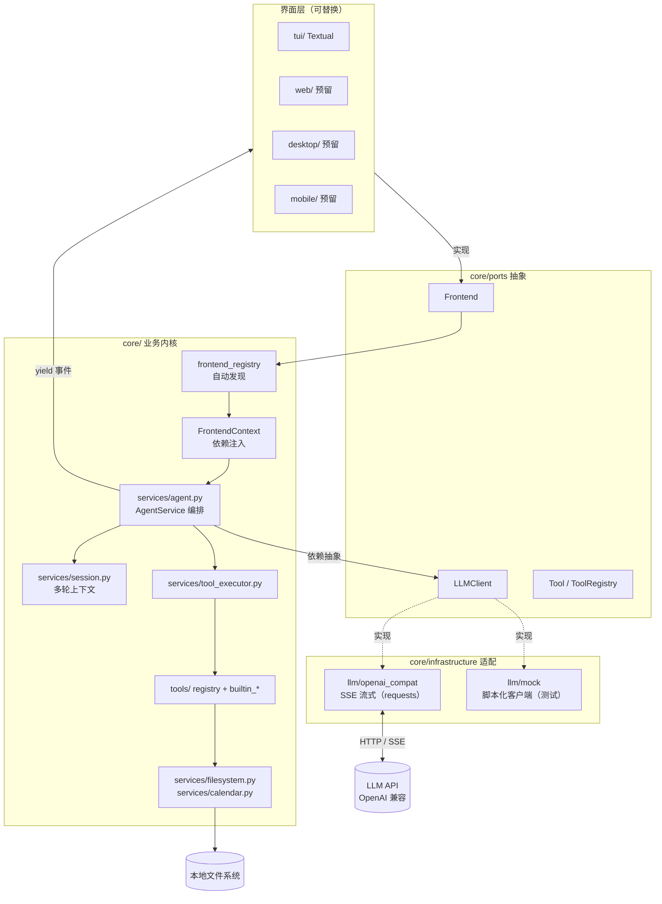

# TAgent —— core 与界面分离的终端智能助手

由 `Agent/Practice02/chat_files.py`（单文件 900 行脚本）重构而来：
**core 是零 UI 依赖的业务内核，tui 只是它的一个渲染器。**
未来新增 Web / Desktop / Mobile 界面，只需在项目根目录新建一个与 `core/` 平级的目录。

---

## 快速开始

```bash
pip install -r requirements.txt

python run.py                       # 启动 TUI（默认）
python run.py --ui list             # 查看所有已注册界面
python run.py "当前工作目录是什么？"   # 带首问启动
python run.py --config ./my.ini     # 指定配置文件
```

> **依赖必须装进"你实际运行 run.py 的那个解释器"。**
> 若 `python run.py` 报「无法加载界面 'tui'：缺少依赖 'textual'」，
> 按报错里给出的完整命令安装即可（它会带上当前解释器的绝对路径）：
>
> ```bash
> "C:\path\to\python.exe" -m pip install -r "E:\projects\Agent\TAgent\requirements.txt"
> ```
>
> 排查界面发现过程：`python run.py --ui list`（列出已注册 + 未能加载的界面及原因），
> 加 `--verbose` 可看到逐包诊断。

TUI 快捷键：

| 按键 | 作用 |
|---|---|
| `Enter` | 发送 |
| `Shift+Enter` | 换行 |
| `Ctrl+X` | 中止本轮生成 |
| `Ctrl+N` | 开新会话 |
| `Ctrl+T` | 显示/隐藏工具面板 |
| `Ctrl+K` | 清空工具面板 |
| `Ctrl+Q` | 退出 |

配置（`config.ini`，也支持 `TAGENT_BASE_URL` / `TAGENT_API_KEY` / `TAGENT_MODEL` 环境变量覆盖）：

```ini
[llm]
base_url = https://api.deepseek.com
api_key  = sk-xxx
model    = deepseek-chat
timeout  = 60

[agent]
max_tool_rounds = 10
max_read_bytes  = 1048576
```

---

## 目录结构

```
TAgent/
├── core/                      # ===== 核心层：不含任何 UI、不含 print/input =====
│   ├── errors.py              #   统一异常层级（UI 只需 except TAgentError）
│   ├── container.py           #   组合根：唯一负责把对象拼起来的地方
│   ├── frontend_registry.py   #   界面自动发现与注册
│   ├── config/                #   配置层：models（数据模型）+ loader（加载策略）
│   ├── domain/                #   领域层：messages / events / filesystem 值对象
│   ├── ports/                 #   端口层：LLM、工具、前端 的抽象契约（依赖倒置）
│   ├── services/              #   服务层：filesystem / calendar / session / agent / tool_executor
│   ├── tools/                 #   工具层：把领域服务包装成 LLM 可调用的 function
│   └── infrastructure/        #   基础设施：llm/openai_compat（唯一 import requests 的地方）
│
├── tui/                       # ===== TUI 界面（Textual）=====
│   ├── frontend.py            #   Frontend 实现 —— core 认识它的唯一入口
│   ├── app.py                 #   App：布局 + 键盘 + 线程调度，无业务逻辑
│   ├── bridge.py              #   防腐层：core 事件 → 界面动作
│   ├── styles.tcss            #   样式（换主题只改这个文件）
│   └── widgets/               #   chat_view / message_card / tool_panel / status_bar / input_box
│
├── web/  desktop/  mobile/  frontend/   # 预留：未来界面与前端工程（见各自 README）
├── tests/                     # core 与 tui 的测试
├── run.py                     # 统一启动入口
└── config.ini
```

---

## 分层架构

依赖方向**只能由外向内**，内层永远不知道外层的存在：

```
   界面层   tui/    web/    desktop/    mobile/     （可替换、可并存）
      │        └──── 都实现 core.ports.frontend.Frontend ────┘
      ▼
   应用层   core/services/agent.py        AgentService：对话编排 + 事件流
      ▼
   领域层   core/domain/  core/services/  filesystem / calendar / session
      ▼
   端口层   core/ports/                   LLM、Tool、Frontend 的抽象接口
      ▲
   适配层   core/infrastructure/llm/      OpenAI 兼容 SSE 客户端 / Mock 客户端
```

### 三条硬约束（新增代码必须遵守）

| # | 约束 | 目的 |
|---|---|---|
| 1 | `core/` 内不得 import 任何 UI 框架（textual / fastapi / PySide …） | 换界面不改业务 |
| 2 | `core/` 内不得出现 `print` / `input`；对外只 `yield` 事件 | 核心可脱离终端测试 |
| 3 | 第三方 SDK（requests 等）只允许出现在 `core/infrastructure/` | 换后端不改业务 |

> 约束 2 有回归测试：`tests/test_agent.py::test_core_never_prints`。

### 关键设计

- **事件驱动**：`AgentService.stream_turn()` 是生成器，逐条 `yield` 领域事件
  （`TurnStarted` → `AssistantTextDelta*` → `ToolCallStarted/Completed` → `TurnCompleted`）。
  界面只是这些事件的不同渲染器。
- **依赖倒置**：`AgentService` 依赖 `LLMClient` 抽象而非 `requests`，
  因此测试里换成 `ScriptedLLMClient` 就能跑通全链路（含工具调用）。
- **结构化工具结果**：文件操作返回 `DirectoryListing` / `FileTypeInfo` / `EditSummary` 等
  值对象，再 `render()` 成给模型看的文本——Web 端可直接渲染结构化数据，无需反解析。
- **组合根**：`AppContainer` 是唯一 `new` 的地方，业务模块之间只依赖抽象。
- **前端零配置发现**：`Frontend.__init_subclass__` 自动登记，`core.frontend_registry`
  扫描与 `core/` 平级的目录完成发现。

### 架构图



---

## 内置工具（12 个，与原脚本一致）

| 工具 | 说明 | 实现位置 |
|---|---|---|
| `getDate` | 当前日期时间（调系统 `date`，失败回退 Python） | `services/calendar.py` |
| `isLeapYear` | 闰年判断 | `services/calendar.py` |
| `getCurrentDirectory` | 当前工作目录 | `services/filesystem.py` |
| `listDirectory` | 列举目录一层条目 | 同上 |
| `getFileType` | 按扩展名推断 MIME / 类别 / 大小 | 同上 |
| `readFile` | 读纯文本（拒绝二进制，UTF-8/GBK 探测） | 同上 |
| `createFile` | 建文件（自动建目录，不覆盖） | 同上 |
| `editFile` | 替换或整体覆盖，保持原编码 | 同上 |
| `createDirectory` / `deleteDirectory` / `deleteFile` / `renameItem` | 目录与文件变更 | 同上 |

**新增一个工具**只需两步（不改任何已有文件）：

```python
# core/tools/builtin_files.py
@builder.tool(
    name="copyFile",
    description="复制文件到目标路径。",
    params={"src": text_param("源路径"), "dst": text_param("目标路径")},
    required=["src", "dst"],
)
def _copy_file(args: dict) -> str:
    return fs.copy(args["src"], args["dst"]).render()   # 业务写在 FileSystemService 里
```

---

## 新增一个界面（例如 Web）

不需要改动 `core/` 或 `run.py` 的任何一行：

1. 在项目根目录新建与 `core/` 平级的包：`web/__init__.py` + `web/frontend.py`；
2. 实现 `Frontend` 子类，声明 `name = "web"`（基类会自动登记）：

   ```python
   class WebFrontend(Frontend):
       name = "web"
       description = "Web 界面"
       def run(self, ctx: FrontendContext) -> int:
           ...
           for event in ctx.agent.stream_turn(ctx.session, text):
               yield to_sse(event)      # 同一条事件流，另一种渲染方式
           return 0
   ```
3. `python run.py --ui web`。

`web/`、`desktop/`、`mobile/`、`frontend/` 四个目录已预留，各自 README 写了完整契约。

---

## 换一个 LLM 后端

只需在 `core/infrastructure/llm/` 下新增一个实现 `LLMClient.stream()` 的类
（把第三方异常翻译成 `core.errors.LLMError` 子类），再在 `AppContainer.build()` 里换掉即可，
业务代码零改动。`tests` 已经用 `ScriptedLLMClient` 验证了这条替换路径。

---

## 测试

```bash
python tests/test_filesystem.py   # 文件系统服务（12 用例）
python tests/test_agent.py        # Agent 全链路 + 容器装配（6 用例，离线）
python tests/test_tui.py          # TUI 无头冒烟（4 用例，Textual run_test）
```

`tests/test_agent.py` 用脚本化 LLM 客户端跑通「流式输出 + 工具调用 + 上下文回灌 + 轮次上限」
整条流水线，且断言 **core 不产生任何终端输出**。
